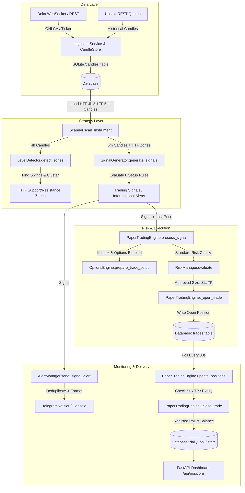

# Algo Monitor Trading Strategy: Comprehensive Engineering & Quantitative Audit

**Audit Date:** October 2026  
**Auditor:** Senior Quantitative Developer, Systematic Trading Researcher & Risk Engineer  
**Audit Scope:** Full static code inspection, execution path trace, database schema & state verification, risk engine analysis, and backtesting validation across all modules of `Algo Monitor`.

---

## 1. Executive Summary

This audit conducted an end-to-end, read-only inspection of the **Algo Monitor** algorithmic trading system. The system is designed as an automated multi-timeframe Support and Resistance (S/R) monitoring and paper-trading platform spanning Indian Equities/Indices ([Upstox](file:///d:/Projects/Algo%20Monitor/algo_monitor/data/upstox.py)) and Crypto Perpetuals ([Delta Exchange India](file:///d:/Projects/Algo%20Monitor/algo_monitor/data/delta_exchange.py)).

### Key Findings Overview

1. **Strictly Paper Trading:** There is **no live order placement capability** implemented in this repository. Neither [UpstoxClient](file:///d:/Projects/Algo%20Monitor/algo_monitor/data/upstox.py#L24-L212) nor [DeltaExchangeClient](file:///d:/Projects/Algo%20Monitor/algo_monitor/data/delta_exchange.py#L28-L254) contains endpoints or methods for placing live exchange orders. All trades are simulated and recorded to a local SQLite database (`trades` table).
2. **Catastrophic Historical Sizing Bug (Reconstruction of ETHUSD):** The previously observed output (`Entry: 2665.80, Quantity: 1496.6497, Reported risk: 20475.29, Reward-to-risk: 1.50`) was caused by a **cross-currency dimensional error**: an INR risk budget (₹20,475.29 from a ~₹10.23 Lakh equity base) was divided directly by a USD stop distance ($13.68/ETH) without currency conversion or leverage ceiling. This approved an exposure of **$3.99 Million USD (~₹33.91 Crore INR)** with an actual stop loss risk of **₹17.40 Lakhs INR** on a ₹10 Lakh account. While partially patched with `fx_rate` and `max_leverage`, contract multiplier logic and tick-size quantization remain missing.
3. **Synthetic Timeframe Data Ingestion:** Due to Upstox API v2 limitations (which rejects `5minute` requests with HTTP 400), [IngestionService](file:///d:/Projects/Algo%20Monitor/algo_monitor/data/ingestion.py#L36-L44) fetches 30-minute candles and stores them with the label `interval="5m"`, and daily candles with the label `interval="4h"`. The strategy is running 5-minute logic on 30-minute bars and 4-hour logic on daily bars for all Indian assets.
4. **Broken Backtesting Engine:** The backtesting runner ([BacktestRunner](file:///d:/Projects/Algo%20Monitor/algo_monitor/backtest/runner.py#L35-L228)) has look-ahead bias (incomplete 4h candle OHLC is visible to intra-day 5m bars), lacks options execution simulation (bypasses [OptionsEngine](file:///d:/Projects/Algo%20Monitor/algo_monitor/options/engine.py#L37-L335)), adds USD profits directly 1:1 into an INR balance without currency conversion, and cannot run multi-instrument portfolio simulations.
5. **No Profitability Evidence:** No verifiable backtesting results exist in the codebase. The live database contains only 4 paper trades (3 open, 1 closed). Any claim of strategy profitability is currently unsupported.

---

## 2. Actual Architecture and Execution Flow

### System Components

| Component | Implementation File | Primary Classes / Functions | Responsibility |
| :--- | :--- | :--- | :--- |
| **Orchestrator** | [main.py](file:///d:/Projects/Algo%20Monitor/algo_monitor/main.py#L37-L458) | `AlgoMonitor`, `main` | Scheduler, lifecycle, worker threads |
| **Configuration** | [settings.py](file:///d:/Projects/Algo%20Monitor/algo_monitor/config/settings.py) <br> [instruments.py](file:///d:/Projects/Algo%20Monitor/algo_monitor/config/instruments.py) | `Settings`, `RiskConfig`, `StrategyConfig`, `Instrument` | Environment configs, watchlist parameters |
| **Database** | [database.py](file:///d:/Projects/Algo%20Monitor/algo_monitor/database.py#L27-L237) | `Database`, `get_database` | SQLite WAL connection, migrations, persistence |
| **Data Ingestion** | [ingestion.py](file:///d:/Projects/Algo%20Monitor/algo_monitor/data/ingestion.py#L47-L233) <br> [candle_store.py](file:///d:/Projects/Algo%20Monitor/algo_monitor/data/candle_store.py) | `IngestionService`, `CandleStore` | REST historical fetching, upsert into DB |
| **Exchange Clients** | [delta_exchange.py](file:///d:/Projects/Algo%20Monitor/algo_monitor/data/delta_exchange.py) <br> [upstox.py](file:///d:/Projects/Algo%20Monitor/algo_monitor/data/upstox.py) <br> [upstox_auth.py](file:///d:/Projects/Algo%20Monitor/algo_monitor/data/upstox_auth.py) | `DeltaExchangeClient`, `DeltaWebSocketClient`, `UpstoxClient`, `UpstoxAuthManager` | REST quotes, WebSocket tickers, TOTP 2FA login |
| **Level Detection** | [levels.py](file:///d:/Projects/Algo%20Monitor/algo_monitor/strategy/levels.py#L93-L367) | `LevelDetector`, `SwingPoint`, `Zone` | Swing highs/lows, clustering, strength scoring |
| **Signal Generation**| [signals.py](file:///d:/Projects/Algo%20Monitor/algo_monitor/strategy/signals.py#L89-L609) | `SignalGenerator`, `Signal`, `SetupType` | 6 setup triggers, SL/TP calculation |
| **Market Scanner** | [scanner.py](file:///d:/Projects/Algo%20Monitor/algo_monitor/strategy/scanner.py#L42-L226) | `Scanner` | Multi-timeframe coordinator (HTF zones + LTF signals) |
| **Risk Engine** | [manager.py](file:///d:/Projects/Algo%20Monitor/algo_monitor/risk/manager.py#L51-L270) | `RiskManager`, `RiskDecision` | Sizing, leverage constraints, circuit breaker |
| **Paper Execution** | [engine.py](file:///d:/Projects/Algo%20Monitor/algo_monitor/trading/engine.py#L30-L605) | `PaperTradingEngine` | Position tracking, SL/TP monitoring, P&L |
| **Options Engine** | [engine.py](file:///d:/Projects/Algo%20Monitor/algo_monitor/options/engine.py#L37-L335) <br> [pricing.py](file:///d:/Projects/Algo%20Monitor/algo_monitor/options/pricing.py) | `OptionsEngine`, `black_scholes_price` | Strike selection, Black-Scholes Greeks & sizing |
| **Alerts & UI** | [notifier.py](file:///d:/Projects/Algo%20Monitor/algo_monitor/alerts/notifier.py#L95-L248) <br> [app.py](file:///d:/Projects/Algo%20Monitor/algo_monitor/dashboard/app.py#L47-L752) | `AlertManager`, `TelegramNotifier`, `create_app` | Telegram alerts, deduplication, FastAPI dashboard |
| **Backtester** | [runner.py](file:///d:/Projects/Algo%20Monitor/algo_monitor/backtest/runner.py#L35-L228) | `BacktestRunner`, `BacktestResult` | Historical chronological simulation |

---

### End-to-End Execution Trace



1. **Market Data Ingestion:**  
   - Scheduled every 15 minutes by [APScheduler](file:///d:/Projects/Algo%20Monitor/algo_monitor/main.py#L149-L155) calling `AlgoMonitor._run_ingestion()`.
   - File: [algo_monitor/data/ingestion.py:L121-182](file:///d:/Projects/Algo%20Monitor/algo_monitor/data/ingestion.py#L121-L182) (`IngestionService._ingest_interval`).
   - Fetches historical bars from Upstox or Delta, removes the uncompleted bar (`valid_candles.pop()`), and upserts into SQLite (`CandleStore.upsert_candles()`).
2. **Candle Processing & Scanning:**  
   - Scheduled every 5 minutes calling `AlgoMonitor._run_scan()`.
   - File: [algo_monitor/strategy/scanner.py:L59-174](file:///d:/Projects/Algo%20Monitor/algo_monitor/strategy/scanner.py#L59-L174) (`Scanner.scan_instrument`).
   - Retrieves up to 500 HTF (`4h`) candles and 300 LTF (`5m`) candles from [CandleStore](file:///d:/Projects/Algo%20Monitor/algo_monitor/data/candle_store.py). Checks data freshness (threshold: 21,600s if market open, else 7,200s).
3. **Swing Detection & S/R Zones:**  
   - File: [algo_monitor/strategy/levels.py:L108-170](file:///d:/Projects/Algo%20Monitor/algo_monitor/strategy/levels.py#L108-L170) (`LevelDetector.find_swing_points`) & [L171-203](file:///d:/Projects/Algo%20Monitor/algo_monitor/strategy/levels.py#L171-L203) (`cluster_into_zones`).
   - Identifies swing points using a ±3 candle window, clusters points within 0.5% tolerance, scans historical candles for reaction touches, calculates composite strength, and retains the top 20 zones.
4. **Setup Detection:**  
   - File: [algo_monitor/strategy/signals.py:L102-204](file:///d:/Projects/Algo%20Monitor/algo_monitor/strategy/signals.py#L102-L204) (`SignalGenerator.generate_signals`).
   - Evaluates the last 2 completed 5m candles against the active 4h zones for the 6 setup types.
5. **Entry / Stop-Loss / Target Calculation:**  
   - File: [algo_monitor/strategy/signals.py:L208-560](file:///d:/Projects/Algo%20Monitor/algo_monitor/strategy/signals.py#L208-L560).
   - Computes `entry_ref` (confirmation candle close), `stop_loss` (percentage beyond zone boundary), and `target` (`entry ± risk * min_reward_risk`).
6. **Risk Validation & Sizing:**  
   - File: [algo_monitor/risk/manager.py:L66-248](file:///d:/Projects/Algo%20Monitor/algo_monitor/risk/manager.py#L66-L248) (`RiskManager.evaluate`).
   - Validates R:R ≥ 1.5, daily loss limit (circuit breaker), maximum positions (≤ 3), duplicate/conflicting positions, data age (< 2h).
   - Sizes position via `min(qty_risk, qty_leverage)` adjusted for FX and lot sizing.
   - Alternatively routed to [OptionsEngine.prepare_trade_setup](file:///d:/Projects/Algo%20Monitor/algo_monitor/options/engine.py#L219-L301) for Indian indices.
7. **Paper Trade Creation:**  
   - File: [algo_monitor/trading/engine.py:L122-198](file:///d:/Projects/Algo%20Monitor/algo_monitor/trading/engine.py#L122-L198) (`PaperTradingEngine.process_signal`) and [L341-417](file:///d:/Projects/Algo%20Monitor/algo_monitor/trading/engine.py#L341-L417) (`_open_trade`).
   - Writes record into SQLite `trades` table with `status = 'open'`.
8. **Alerts & Dashboard Updates:**  
   - File: [algo_monitor/alerts/notifier.py:L112-195](file:///d:/Projects/Algo%20Monitor/algo_monitor/alerts/notifier.py#L112-L195) (`AlertManager.send_signal_alert`).
   - Hashes message; checks 5-minute rate limit and `alert_log` deduplication; transmits via Telegram Bot API and console logger.
   - Scan results and active positions cached in FastAPI application state ([algo_monitor/dashboard/app.py](file:///d:/Projects/Algo%20Monitor/algo_monitor/dashboard/app.py)).

---

## 3. Support and Resistance Identification

### Swing High / Low Mechanics

Implemented in [LevelDetector.find_swing_points](file:///d:/Projects/Algo%20Monitor/algo_monitor/strategy/levels.py#L108-L170):

- **Window Definition:** A swing candidate candle $i$ requires `swing_lookback` (default: 3) closed candles on both sides. Total window size is $2 \times \text{lookback} + 1 = 7$ candles.
- **Comparison Formula:**
  - **Swing High:** $\text{candles}[i].\text{high} \ge \text{candles}[j].\text{high}$ for all $j \in [i - \text{lookback}, i + \text{lookback}]$ where $j \ne i$.
  - **Swing Low:** $\text{candles}[i].\text{low} \le \text{candles}[j].\text{low}$ for all $j \in [i - \text{lookback}, i + \text{lookback}]$ where $j \ne i$.
- **Current Candle Inclusion & Confirmation Delay:**  
  The iteration bounds are `for i in range(self.lookback, n - self.lookback)`. The latest available candle in the array is at index $n - 1$. The latest candidate candle evaluated is $i = n - \text{lookback} - 1$.  
  **The current candle (and the preceding 2 candles) can never be identified as swings.** A swing point is confirmed with an exact **3-candle confirmation delay**. On the 4-hour timeframe, a swing high or low is confirmed **12 hours** after it occurred.
- **Closed Candles Only:** [Scanner](file:///d:/Projects/Algo%20Monitor/algo_monitor/strategy/scanner.py#L86-L89) loads stored candles from [CandleStore](file:///d:/Projects/Algo%20Monitor/algo_monitor/data/candle_store.py), which strips incomplete candles during ingestion.
- **Historical Total:** Configurable via `limit=500` in [Scanner](file:///d:/Projects/Algo%20Monitor/algo_monitor/strategy/scanner.py#L86-L89).

### Behavior in a Strong Bullish Trend

In a persistent uptrend where consecutive candles print higher highs:
- For every candidate candle $i$, the subsequent candle $i+1$ has a higher high ($\text{candles}[i+1].\text{high} > \text{candles}[i].\text{high}$).
- The swing high condition fails for every single candle during the run.
- **Result:** The algorithm detects **zero swing highs** and **zero new resistance zones** throughout the entire upward trend. No new resistance zone is recognized until the trend completely terminates and at least 3 subsequent candles fail to breach the high.

### Zone Clustering

Implemented in [LevelDetector._cluster_one_type](file:///d:/Projects/Algo%20Monitor/algo_monitor/strategy/levels.py#L241-L264):

1. **Separation:** Swings are strictly segregated into Support Swings and Resistance Swings.
2. **Sorting & Grouping:** Swings of the same type are sorted by price ascending. The algorithm iterates through them sequentially, maintaining a `current_group`.
3. **Tolerance Check:**  
   $$\text{group\_avg} = \frac{\sum P_{\text{group}}}{N}$$
   $$\text{distance\_pct} = \frac{|\text{swing.price} - \text{group\_avg}|}{\text{group\_avg}} \times 100$$
   If $\text{distance\_pct} \le \text{zone\_tolerance\_pct}$ (default: 0.5%), the swing is appended to the group. Otherwise, the current group is converted into a Zone and a new group begins.
4. **Boundaries:** Zone boundaries are derived as:
   $$\text{price\_low} = \min(P_{\text{group}}), \quad \text{price\_high} = \max(P_{\text{group}})$$
   **Boundaries use the actual swing price extremes (candle highs for resistance, candle lows for support), NOT closing prices.**
5. **Tolerance Nature:** The clustering tolerance is a **fixed percentage** (`0.5%`). It is **not** volatility-adjusted (no ATR, Bollinger Band, or Standard Deviation adjustment).

### Strength, Touch Counts, and Zone Maintenance

Implemented in [LevelDetector._count_touches](file:///d:/Projects/Algo%20Monitor/algo_monitor/strategy/levels.py#L290-L321) and [_score_zones](file:///d:/Projects/Algo%20Monitor/algo_monitor/strategy/levels.py#L322-L367):

- **Touch Detection:** After initial clustering (where initial touches equal the number of constituent swing points), `_count_touches` loops through **all** historical candles:
  - **Support Touch:** $\text{low} \le \text{zone.price\_high}$ and $\text{low} \ge \text{zone.price\_low} \times 0.99$ and $\text{close} > \text{zone.price\_high}$.
  - **Resistance Touch:** $\text{high} \ge \text{zone.price\_low}$ and $\text{high} \le \text{zone.price\_high} \times 1.01$ and $\text{close} < \text{zone.price\_low}$.
- **Bounce Magnitude:** **Not measured.** Any reaction meeting the threshold is treated identically regardless of whether price bounced 0.1% or 20%.
- **Composite Strength Formula:**
  $$\text{Strength} = 0.4 \times \text{touch\_score} + 0.3 \times \text{recency\_score} + 0.3 \times \text{proximity\_score}$$
  - $\text{touch\_score} = \frac{\text{touches}}{\max(\text{max\_touches}, 1)}$
  - $\text{recency\_score} = \frac{1}{1 + \frac{\text{days\_ago}}{30}}$ (30-day half-life decay)
  - $\text{proximity\_score} = \frac{1}{1 + \frac{\text{distance\_pct}}{5}}$ (distance from current reference price)
- **Broken Zone Invalidation & Polarity Flips:**  
  **Broken zones are neither invalidated nor flipped to opposite polarity in `levels.py`.** When price pierces a support zone, the zone is not deleted or flipped to resistance. It remains in the zone list until it naturally decays in score or drops below `max_zones` (20). (Polarity flips are only referenced in signal logic comments).
- **Overlapping Zones:** Because Support and Resistance are clustered independently, an active Support Zone and an active Resistance Zone can completely overlap at the exact same price band.

---

## 4. Trading Opportunity Detection

All setups are implemented in [algo_monitor/strategy/signals.py](file:///d:/Projects/Algo%20Monitor/algo_monitor/strategy/signals.py). Signals require at least 2 completed candles (`completed[-1]` as `current`, `completed[-2]` as `prev`).

### Individual Setup Audit

#### 1. Support Bounce (`BOUNCE_SUPPORT`)
- **File & Function:** [signals.py:L208-267](file:///d:/Projects/Algo%20Monitor/algo_monitor/strategy/signals.py#L208-L267) (`_check_bounce_support`)
- **Trigger Conditions:**
  1. `zone.zone_type == ZoneType.SUPPORT`
  2. `prev.low <= zone.price_high` and `prev.low >= zone.price_low * 0.995` (previous candle tested the zone)
  3. `current.close > zone.price_high` and `current.is_bullish` (`current.close > current.open`)
- **Direction & Timeframe:** LONG on 5m timeframe.
- **Candle Close Required:** Yes. Both `prev` and `current` must be closed.
- **Failure / False Signal Risks:** A wick dipping into the zone followed by a tiny green candle closing $0.01 above the zone boundary triggers the signal, even in a catastrophic downtrend.

#### 2. Resistance Rejection (`REJECTION_RESISTANCE`)
- **File & Function:** [signals.py:L269-326](file:///d:/Projects/Algo%20Monitor/algo_monitor/strategy/signals.py#L269-L326) (`_check_rejection_resistance`)
- **Trigger Conditions:**
  1. `zone.zone_type == ZoneType.RESISTANCE`
  2. `prev.high >= zone.price_low` and `prev.high <= zone.price_high * 1.005`
  3. `current.close < zone.price_low` and `current.is_bearish` (`current.close < current.open`)
- **Direction & Timeframe:** SHORT on 5m timeframe.
- **Candle Close Required:** Yes.
- **Failure / False Signal Risks:** Sensitive to minor pullbacks during explosive bull breakouts.

#### 3. Resistance Breakout (`BREAKOUT_RESISTANCE`)
- **File & Function:** [signals.py:L327-388](file:///d:/Projects/Algo%20Monitor/algo_monitor/strategy/signals.py#L327-L388) (`_check_breakout_resistance`)
- **Trigger Conditions:**
  1. `zone.zone_type == ZoneType.RESISTANCE`
  2. `prev.close < zone.price_high` (previous candle closed below zone top)
  3. `current.close >= zone.price_high * (1 + breakout_threshold_pct / 100)` (closed at least 0.3% above zone high)
  4. Candle body filter: `current.body_size / current.range_size >= 0.4` (candle body at least 40% of total bar range)
- **Direction & Timeframe:** LONG on 5m timeframe.
- **Candle Close Required:** Yes.
- **Breakout Dependency:** **Breakout detection does NOT depend on a newly confirmed swing high.** It operates completely independently against previously established HTF zones.
- **Failure / False Signal Risks:** Whipsaws in low-liquidity spikes or fake-outs where momentum stalls immediately beyond the 0.3% threshold.

#### 4. Support Breakdown (`BREAKDOWN_SUPPORT`)
- **File & Function:** [signals.py:L389-446](file:///d:/Projects/Algo%20Monitor/algo_monitor/strategy/signals.py#L389-L446) (`_check_breakdown_support`)
- **Trigger Conditions:**
  1. `zone.zone_type == ZoneType.SUPPORT`
  2. `prev.close > zone.price_low`
  3. `current.close <= zone.price_low * (1 - breakout_threshold_pct / 100)` (closed at least 0.3% below zone low)
  4. Candle body filter: `current.body_size / current.range_size >= 0.4`
- **Direction & Timeframe:** SHORT on 5m timeframe.
- **Candle Close Required:** Yes.
- **Breakout Dependency:** Uses established zones independently.

#### 5. Breakout Retest (`RETEST_BREAKOUT`)
- **File & Function:** [signals.py:L448-515](file:///d:/Projects/Algo%20Monitor/algo_monitor/strategy/signals.py#L448-L515) (`_check_retest`)
- **Trigger Conditions:**
  1. `zone.zone_type == ZoneType.RESISTANCE`
  2. Recent breakout: In the preceding 10–20 candles (excluding `current` and `prev`), at least one candle closed above `zone.price_high * 1.002`.
  3. Retest tolerance: $|current.\text{low} - zone.\text{price\_high}| \le \text{zone.mid\_price} \times 0.005$ (0.5% tolerance).
  4. `current.close > zone.price_high` and `current.is_bullish`.
- **Direction & Timeframe:** LONG on 5m timeframe.
- **Candle Close Required:** Yes.

#### 6. Breakdown Retest (`RETEST_BREAKDOWN`)
- **File & Function:** [signals.py:L516-560](file:///d:/Projects/Algo%20Monitor/algo_monitor/strategy/signals.py#L516-L560) (`_check_retest`)
- **Trigger Conditions:**
  1. `zone.zone_type == ZoneType.SUPPORT`
  2. Recent breakdown: At least one candle in preceding 10–20 candles closed below `zone.price_low * 0.998`.
  3. Retest tolerance: $|current.\text{high} - zone.\text{price\_low}| \le \text{zone.mid\_price} \times 0.005$.
  4. `current.close < zone.price_low` and `current.is_bearish`.
- **Direction & Timeframe:** SHORT on 5m timeframe.
- **Candle Close Required:** Yes.

#### 7. Approaching Zone (`APPROACHING_ZONE`)
- **File & Function:** [signals.py:L562-609](file:///d:/Projects/Algo%20Monitor/algo_monitor/strategy/signals.py#L562-L609) (`_check_approaching`)
- **Trigger Conditions:**
  1. $0 < \text{zone.distance\_pct}(current.\text{close}) \le \text{approach\_distance\_pct}$ (default: 1.0%).
  2. `zone.strength >= 0.4`.
- **Prices Output:** `entry_ref = None, stop_loss = None, target = None`.
- **Informational vs Trade Setup:** Handled cleanly. Because `entry_ref`, `stop_loss`, and `target` are `None`, [RiskManager.evaluate](file:///d:/Projects/Algo%20Monitor/algo_monitor/risk/manager.py#L84-L92) immediately rejects the signal (`approved = False`). It generates an alert notification but **cannot** create a paper trade.

### Duplicate Prevention Mechanics

1. **Signal Deduplication:** [signals.py:L75-80](file:///d:/Projects/Algo%20Monitor/algo_monitor/strategy/signals.py#L75-L80) derives `signal_id` as an MD5 hash of:
   `f"{symbol}|{exchange}|{setup_type}|{direction}|{zone.mid_price:.2f}"`
   Stored in an in-memory set `_recent_signal_ids` (capped at 500). **Flaw:** It does not include candle timestamp. Once a setup triggers at a zone, it cannot trigger again until 250 other signals prune the cache or the application restarts. Conversely, restarting the app wipes the set, permitting duplicate alerts.
2. **Alert Log Deduplication:** [notifier.py:L145-164](file:///d:/Projects/Algo%20Monitor/algo_monitor/alerts/notifier.py#L145-L164) checks message hash against SQLite `alert_log` and enforces a 300-second rate limit.
3. **Position Deduplication:** [RiskManager.evaluate](file:///d:/Projects/Algo%20Monitor/algo_monitor/risk/manager.py#L147-L160) rejects signals if an open position for the same symbol, exchange, and direction already exists.

---

## 5. Timeframes and Market Data

### Timeframe Architecture & Interval Aliasing

The strategy is architected around two nominal timeframes:
- **Higher Timeframe (HTF):** Configured as `4h` (`StrategyConfig.htf_interval = "4h"`). Used for S/R zone identification.
- **Lower Timeframe (LTF):** Configured as `5m` (`StrategyConfig.ltf_interval = "5m"`). Used for setup detection and trade entry.

#### The Upstox HTTP 400 Error and Interval Aliasing

Upstox Historical Candle API v2 (`/v2/historical-candle/{instrument_key}/{interval}/{to_date}/{from_date}`) **does not support `5minute` or `4hour` intervals**. Calling Upstox API with `5minute` triggers an **HTTP 400 Bad Request**.

In [algo_monitor/data/ingestion.py:L36-L44](file:///d:/Projects/Algo%20Monitor/algo_monitor/data/ingestion.py#L36-L44), this was addressed by mapping:
```python
_UPSTOX_INTERVALS = {
    "1m": "1minute",
    "5m": "30minute",  # Upstox API only accepts 1minute, 30minute, day, week, month
    "15m": "30minute",
    "30m": "30minute",
    "1h": "30minute",
    "4h": "day",        # Upstox day candle for HTF
    "1d": "day",
}
```
And in [ingestion.py:L231](file:///d:/Projects/Algo%20Monitor/algo_monitor/data/ingestion.py#L231):
```python
self.upstox.get_candles(..., interval=upstox_interval, storage_interval=interval)
```

**Critical Architectural Consequence:**
- 30-minute candles fetched from Upstox are stored in SQLite labeled as `interval = "5m"`.
- Daily candles fetched from Upstox are stored in SQLite labeled as `interval = "4h"`.
- For all Indian instruments (Nifty, Bank Nifty, Reliance, etc.), the strategy is actually detecting S/R zones on **Daily candles** and generating signals on **30-minute candles**, while treating them in math and timestamps as 4-hour and 5-minute bars.

#### The "Insufficient HTF Candles" Warning

- [StrategyConfig.min_history_candles](file:///d:/Projects/Algo%20Monitor/algo_monitor/config/settings.py#L164) defaults to `100`.
- [IngestionService](file:///d:/Projects/Algo%20Monitor/algo_monitor/data/ingestion.py#L70) fetches `lookback_days = 90`.
- Because Indian equity markets trade ~21 days per month, a 90-day window contains only **~63 trading days**.
- When [Scanner](file:///d:/Projects/Algo%20Monitor/algo_monitor/strategy/scanner.py#L86-L89) loaded the "4h" candles (which were actually daily candles), `len(htf_candles)` was ~63.
- Because $63 < 100$, [Scanner](file:///d:/Projects/Algo%20Monitor/algo_monitor/strategy/scanner.py#L152) logged:  
  `Insufficient HTF candles for NIFTY50 (63 < 100)` and generated zero zones and zero signals.
- A partial override was added in [scanner.py:L82](file:///d:/Projects/Algo%20Monitor/algo_monitor/strategy/scanner.py#L82): `min_htf = 30 if is_indian else 100`. However, the underlying data resolution remains aliased.

### Data Ingestion Details

- **Delta Exchange India:**
  - Historical data fetched via REST (`/v2/history/candles`) with pagination ([delta_exchange.py:L217-253](file:///d:/Projects/Algo%20Monitor/algo_monitor/data/delta_exchange.py#L217-L253)). Supports true `4h` and `5m` resolutions.
  - Live market data fetched via WebSocket (`wss://public-socket.india.delta.exchange`) subscribing to the `ticker` channel ([L343-360](file:///d:/Projects/Algo%20Monitor/algo_monitor/data/delta_exchange.py#L343-L360)). Includes auto-reconnect with exponential backoff (1s to 60s) and 30s heartbeat.
- **Upstox:**
  - Entirely REST-based. No WebSocket feed implemented.
  - Live quotes polled from `/v3/market-quote/quotes` or `/v3/market-quote/ltp`.
  - Authentication automated via [UpstoxAuthManager](file:///d:/Projects/Algo%20Monitor/algo_monitor/data/upstox_auth.py) using TOTP 2FA secret and daily scheduled refresh at 08:45 AM IST ([main.py:L179-L186](file:///d:/Projects/Algo%20Monitor/algo_monitor/main.py#L179-L186)).
- **Deduplication:** Enforced by SQLite table constraint:  
  `UNIQUE(symbol, exchange, interval, timestamp)` ([database.py:L110](file:///d:/Projects/Algo%20Monitor/algo_monitor/database.py#L110)).
- **Unfinished Candle Influence:** Strictly prevented in ingestion (`if not valid_candles[-1].is_complete: valid_candles.pop()`) and signal generation (`completed = [c for c in candles if c.is_complete]`).

---

## 6. Entry, Stop-Loss, Target, and Reward-to-Risk

### Mathematical Formulas

| Setup Type | Entry Reference ($P_{\text{entry}}$) | Stop-Loss ($P_{\text{sl}}$) | Target ($P_{\text{target}}$) | Risk Distance ($R$) |
| :--- | :--- | :--- | :--- | :--- |
| **Bounce Support** | $C_{\text{current}}$ | $Z_{\text{low}} \times 0.995$ | $P_{\text{entry}} + R \times 1.5$ | $P_{\text{entry}} - P_{\text{sl}}$ |
| **Rejection Resistance** | $C_{\text{current}}$ | $Z_{\text{high}} \times 1.005$ | $P_{\text{entry}} - R \times 1.5$ | $P_{\text{sl}} - P_{\text{entry}}$ |
| **Breakout Resistance** | $C_{\text{current}}$ | $Z_{\text{low}} \times 0.998$ | $P_{\text{entry}} + R \times 1.5$ | $P_{\text{entry}} - P_{\text{sl}}$ |
| **Breakdown Support** | $C_{\text{current}}$ | $Z_{\text{high}} \times 1.002$ | $P_{\text{entry}} - R \times 1.5$ | $P_{\text{sl}} - P_{\text{entry}}$ |
| **Retest Breakout** | $C_{\text{current}}$ | $Z_{\text{low}} \times 0.998$ | $P_{\text{entry}} + R \times 1.5$ | $P_{\text{entry}} - P_{\text{sl}}$ |
| **Retest Breakdown** | $C_{\text{current}}$ | $Z_{\text{high}} \times 1.002$ | $P_{\text{entry}} - R \times 1.5$ | $P_{\text{sl}} - P_{\text{entry}}$ |

### Target Flaw: Total Neglect of Opposing Zones

In every setup, target calculation is **hardcoded to a fixed multiple of risk**:
$$P_{\text{target}} = P_{\text{entry}} \pm (R \times \text{min\_reward\_risk})$$

**The strategy completely ignores opposing Support/Resistance zones when setting targets.**  
For example, in a Support Bounce, if an overhead 4-hour Resistance Zone sits only 0.3% above entry, the algorithm still projects a target 1.5% away, setting an exit directly beyond major resistance.

### Reward-to-Risk Enforcement

- Enforced in [RiskManager.evaluate:L120-124](file:///d:/Projects/Algo%20Monitor/algo_monitor/risk/manager.py#L120-L124):
  $$\text{rr\_ratio} = \frac{\text{reward\_per\_unit}}{\text{risk\_per\_unit}}$$
  If $\text{round}(\text{rr\_ratio}, 2) < 1.5$, the trade is rejected.
- Because the signal generator computes target directly as $R \times 1.5$, standard signals always yield an R:R of exactly 1.50 unless modified by options pricing.

### Slippage, Costs, and Execution Assumptions

- Fees and slippage are estimated as fixed percentages: $\text{fee\_rate} = 0.0005$ (5 bps), $\text{slippage\_rate} = 0.0003$ (3 bps) applied twice (entry + exit).
- [RiskManager:L202-206](file:///d:/Projects/Algo%20Monitor/algo_monitor/risk/manager.py#L202-L206) emits a warning if estimated costs exceed 30% of gross reward, but **does not reject the trade**.
- In paper trade monitoring ([trading/engine.py:L469-483](file:///d:/Projects/Algo%20Monitor/algo_monitor/trading/engine.py#L469-L483)), fills are assumed at the exact stop-loss or target price. Gaps through stop-losses are ignored.
- Tick sizes are not checked or quantized.

### Illustrative Numerical Example

*(The following prices are hypothetical and provided strictly for mathematical illustration)*

**Setup: Resistance Breakout on Instrument XYZ**
- Resistance Zone: $[2,480.00 - 2,500.00]$
- Previous 5m Close: $2,495.00$ (inside zone)
- Current 5m Close ($C_{\text{current}}$): $2,510.00$ (breakout threshold = $2,500 \times 1.003 = 2,507.50$; $2,510.00 \ge 2,507.50$, body ratio $> 0.40$)
- **Entry Price:** $2,510.00$
- **Stop-Loss Price:** $Z_{\text{low}} \times 0.998 = 2,480.00 \times 0.998 = 2,475.04$
- **Risk Per Unit:** $2,510.00 - 2,475.04 = 34.96$
- **Target Price:** $2,510.00 + (34.96 \times 1.5) = 2,562.44$
- **Reward-to-Risk:** $(2,562.44 - 2,510.00) / 34.96 = 1.50$ (Approved)

---

## 7. Risk Management and Position Sizing

### Risk Engine Parameters

Defined in [algo_monitor/config/settings.py:L171-209](file:///d:/Projects/Algo%20Monitor/algo_monitor/config/settings.py#L171-L209):
- **Starting Capital:** Configured as ₹15,000 (`PAPER_TRADING_BALANCE = 15000`), though fallback defaults in [app.py:L645](file:///d:/Projects/Algo%20Monitor/algo_monitor/dashboard/app.py#L645) and [performance.py:L105](file:///d:/Projects/Algo%20Monitor/algo_monitor/trading/performance.py#L105) reference ₹1,000,000.
- **Risk Per Trade:** 2% (`RISK_PER_TRADE = 0.02`).
- **Maximum Concurrent Positions:** 3 (`MAX_POSITIONS = 3`).
- **Daily Loss Circuit Breaker:** 5% (`MAX_DAILY_LOSS = 0.05`). Evaluated against `daily_realised_pnl`. If tripped, no further trades are approved until UTC midnight.
- **Maximum Broker Leverage:** 3.0x (`MAX_LEVERAGE = 3.0`).
- **Maximum Margin Allocation Per Trade:** 50% (`MAX_CAPITAL_PER_TRADE_PCT = 0.5`).
- **USD/INR Conversion Rate:** Fixed default 85.0 (`USD_INR_RATE = 85.0`).
- **Correlation Restrictions:** **None.** The engine allows 3 concurrent long positions across correlated assets (e.g. NIFTY50, BANKNIFTY, and HDFCBANK).

---

### Detailed Investigation of the Observed ETHUSD Trade

The user requested an investigation into the observed trade:
> **Entry:** 2665.80  
> **Quantity:** 1496.6497  
> **Reported risk:** 20475.29  
> **Reward-to-risk:** 1.50  

#### Exact Mathematical Reconstruction

1. **The Stop Distance:**  
   $$\text{Risk per unit} = \frac{\text{Reported risk}}{\text{Quantity}} = \frac{20,475.29}{1,496.6497} = 13.68075 \text{ USD}$$
   $$\text{Stop-Loss} = 2,665.80 - 13.68075 = 2,652.12 \text{ USD}$$
2. **The Account Balance:**  
   With `risk_per_trade = 0.02` (2% risk budget):
   $$\text{Account Equity} = \frac{\text{Risk budget}}{0.02} = \frac{20,475.29}{0.02} = \mathbf{1,023,764.50 \text{ INR}}$$
   (The account was operating from the default ₹10,000,000 / ₹10 Lakh equity base).
3. **The Sizing Flaw:**  
   In the unpatched risk code, position sizing was executed as:
   ```python
   # Risk budget computed in INR:
   risk_budget = current_balance * self.config.risk_per_trade  # = 20,475.29 INR
   # Divided by stop distance in USD:
   quantity = risk_budget / risk_per_unit  # = 20,475.29 / 13.68075 = 1496.6497
   ```
   Because `ETH` was not specifically caught in `_apply_lot_sizing`, it hit `else: return round(quantity, 4)` = `1496.6497`.
4. **The Resulting Exposure:**
   - **Nominal Position:** $1,496.6497 \text{ ETH}$
   - **Dollar Notional Exposure:** $1,496.6497 \times \$2,665.80 = \mathbf{\$3,989,768.77 \text{ USD}}$
   - **Rupee Notional Exposure (at 85 USD/INR):** $\mathbf{₹339,130,345.45 \text{ INR}}$ (**₹33.91 Crore**)
   - **Actual Stop Loss Loss in INR:** $1,496.6497 \times \$13.68075 \times 85 = \mathbf{₹1,740,400.00 \text{ INR}}$ (a 170% loss of the entire ₹10 Lakh account balance on a single trade).
5. **Contract Multiplier Ignored:** On Delta Exchange India, ETH perpetual futures are traded in standardized contracts (e.g. 1 contract = 0.001 ETH or 1 contract = 1 USD). The system passed raw ETH token units without contract specification mapping.

#### Evaluation of Current State

In [algo_monitor/risk/manager.py:L162-184](file:///d:/Projects/Algo%20Monitor/algo_monitor/risk/manager.py#L162-L184), this was addressed by converting `balance_quote = current_balance / fx_rate`, capping via `max_leverage` (3.0x), and rounding ETH to 2 decimals. Under the current code, on a ₹15,000 capital base at 85 USD/INR ($176.47 USD), maximum leverage bounds ETHUSD sizing to $\approx 0.11 \text{ ETH}$ (as seen in database records 4 and 6).  
**However**, the lack of exchange contract lot translation remains a flaw for live execution.

---

## 8. Backtesting and Performance Evidence

### Engine Audit ([algo_monitor/backtest/runner.py](file:///d:/Projects/Algo%20Monitor/algo_monitor/backtest/runner.py))

1. **Look-Ahead Bias in HTF Candles:**  
   In [runner.py:L117-124](file:///d:/Projects/Algo%20Monitor/algo_monitor/backtest/runner.py#L117-L124):
   ```python
   htf_window = [c for c in htf_candles if c.timestamp <= current.timestamp]
   zones = self.level_detector.detect_zones(htf_window, reference_price=current.close)
   ```
   Because `Candle.timestamp` represents the candle's **start (open) time**, when an intra-day 5m candle at 09:30 UTC checks `c.timestamp <= current.timestamp`, the 4h candle that opened at 08:00 UTC (and runs until 12:00 UTC) is included in `htf_window`. **The backtester sees the completed high, low, and close of a 4-hour bar that has not yet finished in simulated time.**
2. **Options Trading Completely Bypassed:**  
   While live paper trading automatically routes indices to [OptionsEngine](file:///d:/Projects/Algo%20Monitor/algo_monitor/options/engine.py#L37-L335), [BacktestRunner](file:///d:/Projects/Algo%20Monitor/algo_monitor/backtest/runner.py#L188-L200) only calls `self.risk_manager.evaluate()`. It tests underlying spot/futures prices directly and cannot backtest options strategies.
3. **Cross-Currency Accounting Failure:**  
   In [runner.py:L157-166](file:///d:/Projects/Algo%20Monitor/algo_monitor/backtest/runner.py#L157-L166):
   ```python
   gross = (exit_price - pos["entry"]) * qty
   fees = pos["entry"] * qty * self.risk_config.fee_rate * 2
   net = gross - fees - slippage
   balance += net
   ```
   For crypto instruments (BTCUSD, ETHUSD), `net` is computed in **USD**, while `balance` starts at ₹15,000 **INR**. The backtester adds USD dollar profits 1:1 directly into the INR balance without multiplying by `usd_inr_rate`.
4. **Execution Mechanics:**
   - Stop-loss and target fills are assumed at exact price levels with no gap risk.
   - If a single historical bar breaches both stop-loss and target, the backtester prioritizes stop-loss ([runner.py:L142-154](file:///d:/Projects/Algo%20Monitor/algo_monitor/backtest/runner.py#L142-L154)), but cannot model intra-candle price sequence.
5. **Portfolio & Multi-Instrument Limitations:**  
   Backtests run on a single instrument at a time. Multi-instrument concurrent position limits, correlation, and portfolio-level drawdown cannot be tested.

### Performance Evidence

- **Backtest Data:** No backtesting result reports or performance logs are committed to the codebase.
- **Database Trade Records:** As of October 2026, SQLite database `algo_monitor.db` contains exactly **4 trades**:
  - `Trade #3`: `BTC_INR` (Delta), short, open, entry ₹8,233,578, qty 0.003
  - `Trade #4`: `ETHUSD` (Delta), long, **closed**, entry $2,500.15, exit $2,529.43 (`target_hit`), net P&L ₹236.38
  - `Trade #5`: `ETH_INR` (Delta), long, open, entry ₹249,370, qty 0.09
  - `Trade #6`: `ETHUSD` (Delta), long, open, entry $2,544.00, qty 0.11
- **Verdict:** There is **zero statistically significant evidence** supporting the profitability of this trading strategy.

---

## 9. Paper-Trading Lifecycle and Notifications

### Paper-Trading Lifecycle

- **State Persistence:** Paper positions are persisted in SQLite `trades` table. Because `main.py` instantiates [PaperTradingEngine](file:///d:/Projects/Algo%20Monitor/algo_monitor/trading/engine.py#L30-L605) which reads from `trades WHERE status = 'open'`, **open positions survive application restarts intact**.
- **Monitoring Loop:** [AlgoMonitor._update_positions](file:///d:/Projects/Algo%20Monitor/algo_monitor/main.py#L255-L290) runs every 30 seconds:
  - Fetches latest prices from Delta WebSocket cache (`_latest_prices`) or REST ticker fallback.
  - Passes prices to [PaperTradingEngine.update_positions](file:///d:/Projects/Algo%20Monitor/algo_monitor/trading/engine.py#L421-L510).
  - Evaluates SL, TP, and session expiry (intraday: 375 minutes; swing: 14 days).
  - Closes filled positions, updates balance in `system_state`, updates `daily_pnl` table, and sends a Telegram closure alert.
- **Data Outage Impact:** If price updates fail, positions remain in their last state. They are neither closed nor liquidated.
- **Absence of Real Order Routing:** Static analysis confirmed that no trading API endpoints (`POST /order`, `POST /v2/orders`, etc.) exist anywhere in the code.

### Telegram Alerts & Dashboard

- **Alert Manager:** [AlertManager](file:///d:/Projects/Algo%20Monitor/algo_monitor/alerts/notifier.py#L95-L248) supports `ConsoleNotifier` and `TelegramNotifier`.
- **Informational vs Trade Alerts:** Informational alerts (`APPROACHING_ZONE`) are formatted with zone distance and a warning notice. Trade alerts include Entry, SL, Target, and R:R with a clear disclaimer: `Status: PAPER TRADING ONLY`.
- **Dashboard Discrepancies & Fallbacks:**
  - In [algo_monitor/dashboard/app.py:L570-581](file:///d:/Projects/Algo%20Monitor/algo_monitor/dashboard/app.py#L570-L581), open position unrealized P&L is computed as `(current_price - entry) * qty` **without FX conversion**. For ETHUSD, it shows dollar P&L mixed directly into rupee balances.
  - If live price feeds fail, [dashboard/app.py:L817-843](file:///d:/Projects/Algo%20Monitor/algo_monitor/dashboard/app.py#L817-L843) falls back to hardcoded static prices in `_DEFAULT_PRICES`, or generates synthetic prices via a pseudo-random hash: `abs(hash(symbol)) % 1500 + 150.0`.
  - The dashboard runs on FastAPI with **no authentication, API keys, or CORS restrictions**. Anyone with network access to the port can toggle market feeds or trigger token refreshes.

---

## 10. Critical Bugs, False-Signal Scenarios & Flaws

### Major Findings Audit

#### Finding 1: Upstox 5-Minute and 4-Hour Timeframe Aliasing
- **Severity:** High
- **Evidence:** [algo_monitor/data/ingestion.py:L36-L44](file:///d:/Projects/Algo%20Monitor/algo_monitor/data/ingestion.py#L36-L44), [L222-232](file:///d:/Projects/Algo%20Monitor/algo_monitor/data/ingestion.py#L222-L232)
- **Current Behavior:** Upstox 30-minute candles are fetched and saved as `5m`. Daily candles are fetched and saved as `4h`.
- **Why It Matters:** The strategy is operating on vastly different time horizons than designed (30m vs 5m; 1D vs 4h), invalidating technical patterns, holding times, and candle body filters.
- **Recommended Fix:** Resample 1-minute historical data into true 5-minute and 4-hour OHLCV bars using Pandas or an internal resampler, rather than aliasing 30m and 1D feeds.

#### Finding 2: Look-Ahead Bias in Backtester HTF Window
- **Severity:** High
- **Evidence:** [algo_monitor/backtest/runner.py:L117-119](file:///d:/Projects/Algo%20Monitor/algo_monitor/backtest/runner.py#L117-L119)
- **Current Behavior:** `c.timestamp <= current.timestamp` includes the open 4-hour candle that started at or before the current 5-minute candle.
- **Why It Matters:** The backtester leaks future high/low/close data of the active 4-hour period into the 5-minute decision logic.
- **Recommended Fix:** Ensure `c.timestamp + timedelta(hours=4) <= current.timestamp` so only strictly completed HTF candles are visible to the level detector.

#### Finding 3: Lack of Opposing Zone Awareness in Target Setting
- **Severity:** Medium
- **Evidence:** [algo_monitor/strategy/signals.py:L241](file:///d:/Projects/Algo%20Monitor/algo_monitor/strategy/signals.py#L241), [L299](file:///d:/Projects/Algo%20Monitor/algo_monitor/strategy/signals.py#L299), [L362](file:///d:/Projects/Algo%20Monitor/algo_monitor/strategy/signals.py#L362), [L422](file:///d:/Projects/Algo%20Monitor/algo_monitor/strategy/signals.py#L422)
- **Current Behavior:** Targets are calculated purely as $P_{\text{entry}} \pm R \times 1.5$.
- **Why It Matters:** Bounces from support frequently place targets directly on top of, or beyond, major resistance zones, resulting in low win rates.
- **Recommended Fix:** Set target as $\min(P_{\text{entry}} + R \times 1.5, \text{next\_resistance\_zone.price\_low})$. If the resulting R:R $< 1.5$, reject the setup.

#### Finding 4: Dashboard Unrealized P&L Currency Inconsistency
- **Severity:** Medium
- **Evidence:** [algo_monitor/dashboard/app.py:L570-581](file:///d:/Projects/Algo%20Monitor/algo_monitor/dashboard/app.py#L570-L581)
- **Current Behavior:** Open positions compute `unrealized_pnl` as raw price difference $\times$ quantity. For USD contracts, this is in USD, while the dashboard displays it as INR.
- **Why It Matters:** Distorts dashboard P&L metrics by a factor of 85x for crypto contracts while trades remain open.
- **Recommended Fix:** Multiply USD symbol unrealized P&L by `usd_inr_rate` in `/api/positions`.

#### Finding 5: Backtester Cross-Currency Accumulation
- **Severity:** High
- **Evidence:** [algo_monitor/backtest/runner.py:L166](file:///d:/Projects/Algo%20Monitor/algo_monitor/backtest/runner.py#L166)
- **Current Behavior:** Backtester adds USD net P&L directly into INR starting balance.
- **Why It Matters:** Makes backtest P&L for crypto pairs completely meaningless.
- **Recommended Fix:** Multiply USD trade P&L by `usd_inr_rate` before updating backtest balance.

#### Finding 6: Absence of Crypto Perpetual Contract Lot Specifications
- **Severity:** High
- **Evidence:** [algo_monitor/risk/manager.py:L255-270](file:///d:/Projects/Algo%20Monitor/algo_monitor/risk/manager.py#L255-L270), [algo_monitor/config/instruments.py:L43-74](file:///d:/Projects/Algo%20Monitor/algo_monitor/config/instruments.py#L43-L74)
- **Current Behavior:** Positions are sized in continuous float quantities (e.g. 0.11 ETH) rather than integer lots of standardized exchange contracts.
- **Why It Matters:** If live execution is ever connected, orders will be rejected by the exchange API for invalid lot size or tick size violations.
- **Recommended Fix:** Add `contract_value`, `lot_size`, and `tick_size` to [Instrument](file:///d:/Projects/Algo%20Monitor/algo_monitor/config/instruments.py#L44-L74) and quantize sizing accordingly.

---

## 11. Missing or Incomplete Features

1. **Live Broker Order Routing:** No order management system (OMS) or broker execution adapter exists.
2. **True Timeframe Resampling:** Inability to aggregate 1-minute Upstox candles into genuine 5-minute or 4-hour candles.
3. **Volatility-Adjusted Zone Tolerance:** Zone clustering uses a fixed 0.5% tolerance rather than ATR-based dynamic bands.
4. **Opposing Zone Target Truncation:** Strategy does not check where the next opposing S/R zone lies.
5. **Multi-Asset Portfolio Backtesting:** Backtester cannot run cross-asset simulations with shared capital and concurrent position limits.
6. **Dashboard Authentication:** No password, token, or session protection on the FastAPI web service.
7. **Zone Polarity Flip Tracking:** Broken support is not dynamically transformed into resistance.

---

## 12. Prioritized Recommendations

### Priority 1: Critical (Must Address Before Trusting Sizing or Backtests)
1. **Implement True Intraday Candle Resampling:** In [algo_monitor/data/ingestion.py](file:///d:/Projects/Algo%20Monitor/algo_monitor/data/ingestion.py), ingest 1-minute bars from Upstox and resample them locally into true 5-minute and 4-hour bars using Pandas. Eliminate the 30-minute and daily interval aliasing.
2. **Fix Backtester Look-Ahead Bias and Currency Conversion:** Update [BacktestRunner](file:///d:/Projects/Algo%20Monitor/algo_monitor/backtest/runner.py) to strictly lag HTF candles by 4 hours ($t + 4\text{h} \le t_{\text{current}}$) and multiply USD trade results by `usd_inr_rate`.
3. **Formalize Contract Specifications:** Add `contract_size`, `min_lot`, and `tick_size` to [Instrument](file:///d:/Projects/Algo%20Monitor/algo_monitor/config/instruments.py#L44-L74) dataclass and enforce them in [RiskManager._apply_lot_sizing](file:///d:/Projects/Algo%20Monitor/algo_monitor/risk/manager.py#L255-L270).

### Priority 2: Strategy Quality (Address to Improve Signal Reliability)
4. **Incorporate Opposing S/R Zones in Target Projection:** Check the nearest opposing zone before finalizing target. If $P_{\text{target}}$ exceeds the next zone, cap it at that zone's boundary. Reject the signal if R:R falls below 1.5.
5. **Implement Dynamic ATR Zone Clustering:** Replace the fixed 0.5% tolerance with an ATR multiple (e.g. $0.5 \times \text{ATR}_{14}$) to adapt to high- and low-volatility regimes.
6. **Implement Zone Polarity Tracking:** When a Support zone experiences a verified breakdown, update its type to Resistance in the database so retest setups can leverage the flipped level.

### Priority 3: Platform & Security
7. **Fix Dashboard Currency Formatting:** Update `/api/positions` in [app.py](file:///d:/Projects/Algo%20Monitor/algo_monitor/dashboard/app.py) to convert unrealized P&L to INR for USD pairs.
8. **Secure Dashboard Endpoints:** Add HTTP Basic Auth or Bearer token verification to FastAPI routes before deploying to public or local networks.

---

## 13. Implementation Status Matrix

| Component | Status | Verification Evidence / Location |
| :--- | :--- | :--- |
| **Delta REST Candle Ingestion** | **Implemented & Verified** | [delta_exchange.py:L151-253](file:///d:/Projects/Algo%20Monitor/algo_monitor/data/delta_exchange.py#L151-L253) |
| **Delta WebSocket Live Ticker** | **Implemented & Verified** | [delta_exchange.py:L256-400](file:///d:/Projects/Algo%20Monitor/algo_monitor/data/delta_exchange.py#L256-L400) |
| **Upstox TOTP 2FA Auto-Auth** | **Implemented & Verified** | [upstox_auth.py:L23-150](file:///d:/Projects/Algo%20Monitor/algo_monitor/data/upstox_auth.py) |
| **Upstox Candle Ingestion** | **Partially Implemented** | Aliased: 30m stored as 5m, 1D stored as 4h ([ingestion.py:L36-44](file:///d:/Projects/Algo%20Monitor/algo_monitor/data/ingestion.py#L36-L44)) |
| **Swing High/Low Detection** | **Implemented & Verified** | Lookback ±3 closed candles ([levels.py:L108-170](file:///d:/Projects/Algo%20Monitor/algo_monitor/strategy/levels.py#L108-L170)) |
| **Fixed % Zone Clustering** | **Implemented & Verified** | 0.5% tolerance grouping ([levels.py:L171-264](file:///d:/Projects/Algo%20Monitor/algo_monitor/strategy/levels.py#L171-L264)) |
| **Volatility-Adjusted Clustering** | **Not Implemented** | Only fixed percentage is supported |
| **Zone Invalidation / Polarity Flip**| **Not Implemented** | Broken zones remain active until decaying in score |
| **Setup: Support Bounce** | **Implemented & Verified** | [signals.py:L208-267](file:///d:/Projects/Algo%20Monitor/algo_monitor/strategy/signals.py#L208-L267) |
| **Setup: Resistance Rejection** | **Implemented & Verified** | [signals.py:L269-326](file:///d:/Projects/Algo%20Monitor/algo_monitor/strategy/signals.py#L269-L326) |
| **Setup: Resistance Breakout** | **Implemented & Verified** | Independent of new swing points ([signals.py:L327-388](file:///d:/Projects/Algo%20Monitor/algo_monitor/strategy/signals.py#L327-L388)) |
| **Setup: Support Breakdown** | **Implemented & Verified** | [signals.py:L389-446](file:///d:/Projects/Algo%20Monitor/algo_monitor/strategy/signals.py#L389-L446) |
| **Setup: Breakout/Breakdown Retest**| **Implemented & Verified** | 10–20 candle lookback ([signals.py:L448-560](file:///d:/Projects/Algo%20Monitor/algo_monitor/strategy/signals.py#L448-L560)) |
| **Setup: Approaching Zone** | **Implemented & Verified** | Informational alert; rejected for paper execution ([signals.py:L562-609](file:///d:/Projects/Algo%20Monitor/algo_monitor/strategy/signals.py#L562-L609)) |
| **Opposing Zone Target Truncation** | **Not Implemented** | Fixed $R \times 1.5$ calculation only |
| **Position Sizing (Currency Aware)**| **Implemented & Verified** | Patched with `fx_rate` & leverage bounds ([manager.py:L162-184](file:///d:/Projects/Algo%20Monitor/algo_monitor/risk/manager.py#L162-L184)) |
| **Exchange Contract Lot Sizing** | **Not Implemented** | Uses raw floating units; no exchange contract mapping |
| **Daily Loss Circuit Breaker** | **Implemented & Verified** | 5% threshold ([manager.py:L126-139](file:///d:/Projects/Algo%20Monitor/algo_monitor/risk/manager.py#L126-L139)) |
| **Index Options Auto-Routing** | **Implemented & Verified** | Black-Scholes ATM selection ([options/engine.py:L37-335](file:///d:/Projects/Algo%20Monitor/algo_monitor/options/engine.py#L37-L335)) |
| **Paper Trade Execution Engine** | **Implemented & Verified** | SQLite persistence, SL/TP checks ([trading/engine.py:L30-605](file:///d:/Projects/Algo%20Monitor/algo_monitor/trading/engine.py#L30-L605)) |
| **Live Order Execution (Broker)** | **Not Implemented** | Strictly paper trading; no order routing code exists |
| **Historical Backtest Runner** | **Partially Implemented** | Exists but contains look-ahead bias, currency errors, and no options support ([runner.py:L35-228](file:///d:/Projects/Algo%20Monitor/algo_monitor/backtest/runner.py#L35-L228)) |
| **Telegram Alert Delivery** | **Implemented & Verified** | Deduplicated via message hash & rate limiting ([notifier.py:L95-248](file:///d:/Projects/Algo%20Monitor/algo_monitor/alerts/notifier.py#L95-L248)) |
| **Web Dashboard** | **Implemented & Verified** | FastAPI app with live pricing fallbacks ([dashboard/app.py:L47-752](file:///d:/Projects/Algo%20Monitor/algo_monitor/dashboard/app.py#L47-L752)) |
